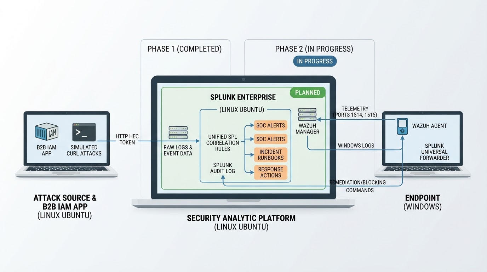
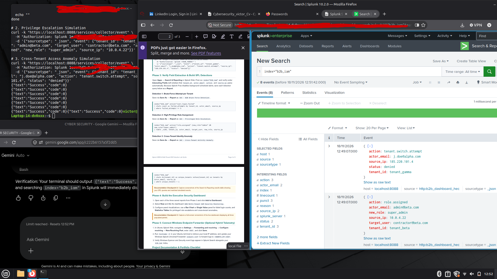
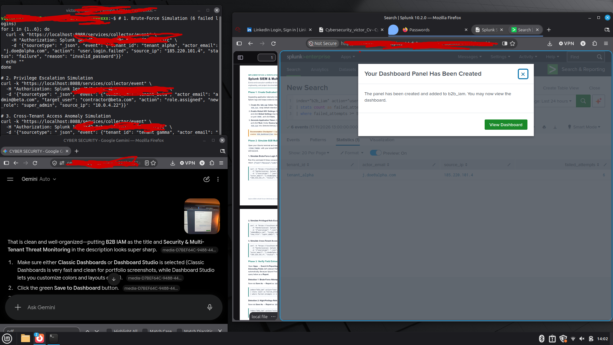
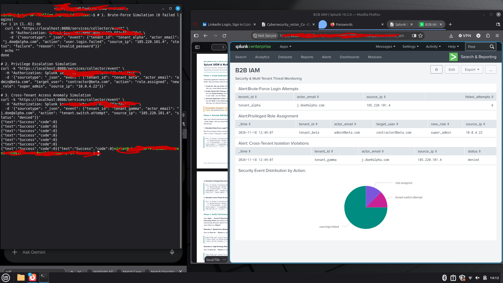

# Multi-Tenant B2B IAM Threat Detection Pipeline (Splunk Enterprise SIEM)

## Project Overview
This project demonstrates an end-to-end, pre-production SIEM log ingestion and threat detection pipeline built on Splunk Enterprise (Ubuntu Linux). Designed to monitor a multi-tenant B2B Identity and Access Management (IAM) application, the architecture ingests structured JSON telemetry over HTTPS via Splunk's HTTP Event Collector (HEC) and applies SPL (Search Processing Language) correlation rules to detect authentication abuse, privilege escalation, and cross-tenant isolation breaches.



### Project Phases
- **Phase 1:** B2B IAM Threat Detection Pipeline via Splunk HTTP Event Collector (HEC) *(documented below)*
- **Phase 2:** [Windows Endpoint Telemetry to Linux Wazuh Manager (Manager-Only)](./phase-2-wazuh-agent-manager/README.md)
- **Phase 3:** Splunk Enterprise Indexing, Correlation & SOC Dashboards *(Next)*

## Architecture & Security Controls
- **SIEM Platform:** Splunk Enterprise deployed on Ubuntu Linux.
- **Data Isolation:** Dedicated `b2b_iam` index to segregate application security telemetry from host OS logs and optimize daily license ingestion limits.
- **Transport Security & Ingestion:** SSL-encrypted HTTP Event Collector (HEC) endpoint listening on port `8088`, restricted by token scope strictly to the `b2b_iam` index using structured `_json` parsing.
- **Credential Hygiene:** API bearer tokens are stored in backend environment variables and redacted from all public documentation and test scripts.

## Pre-Production Telemetry Simulation
To validate schema-on-read JSON field extraction and SPL detection logic prior to live backend integration, synthetic attack payloads were injected via REST API (`curl`):

### 1. Brute-Force Credential Stuffing (`tenant_alpha`)
```bash
for i in {1..6}; do
  curl -k "https://localhost:8088/services/collector/event" \
    -H "Authorization: Splunk <YOUR_HEC_TOKEN>" \
    -d '{"sourcetype": "_json", "event": {"tenant_id": "tenant_alpha", "actor_email": "j.doe@alpha.com", "action": "user.login.failed", "source_ip": "185.220.101.4", "status": "failure", "reason": "invalid_password"}}'
done
```

### 2. Unauthorized Privilege Escalation (`tenant_beta`)
```bash
curl -k "https://localhost:8088/services/collector/event" \
  -H "Authorization: Splunk <YOUR_HEC_TOKEN>" \
  -d '{"sourcetype": "_json", "event": {"tenant_id": "tenant_beta", "actor_email": "admin@beta.com", "target_user": "contractor@beta.com", "action": "role.assigned", "new_role": "super_admin", "source_ip": "10.0.4.22"}}'
```

### 3. Cross-Tenant Access Anomaly (`tenant_gamma`)
```bash
curl -k "https://localhost:8088/services/collector/event" \
  -H "Authorization: Splunk <YOUR_HEC_TOKEN>" \
  -d '{"sourcetype": "_json", "event": {"tenant_id": "tenant_gamma", "actor_email": "j.doe@alpha.com", "action": "tenant.switch.attempt", "source_ip": "185.220.101.4", "status": "denied"}}'
```

## SPL Detection Rules

### Alert 1: Brute-Force Login Attempts
Flags repeated authentication failures exceeding threshold limits within a tenant environment:
```spl
index="b2b_iam" action="user.login.failed"
| stats count as failed_attempts by tenant_id, actor_email, source_ip
| where failed_attempts >= 5
```

### Alert 2: Privileged Role Assignments
Detects elevated role grants (`admin` or `super_admin`) for immediate SOC triage:
```spl
index="b2b_iam" action="role.assigned" (new_role="admin" OR new_role="super_admin")
| table _time, tenant_id, actor_email, target_user, new_role, source_ip
```

### Alert 3: Cross-Tenant Isolation Violations
Identifies unauthorized attempts by an actor from one tenant to access another tenant's workspace:
```spl
index="b2b_iam" action="tenant.switch.attempt" status="denied"
| table _time, tenant_id, actor_email, source_ip, status
```

### Executive Overview: Security Event Distribution by Action
```spl
index="b2b_iam"
| stats count by action
```

## Dashboard & Validation Proof
- **HEC Token & Index Configuration:**  
  
- **REST API Event Injection:**  
  
- **B2B IAM Threat Monitoring Dashboard:**  
  

## Project Roadmap
- **Phase 1 (Completed):** B2B IAM threat detection via Splunk HTTP Event Collector (HEC), JSON telemetry simulation, and SPL correlation rules.
- **Phase 2 (Completed):** Windows endpoint telemetry to Linux Wazuh Manager (`v4.14.10`) in a manager-only setup writing structured alerts to `/var/ossec/logs/alerts/alerts.json` ([Phase 2 Documentation](./phase-2-wazuh-agent-manager/README.md)).
- **Phase 3 (Next):** Splunk Enterprise indexing of `alerts.json`, unified SPL correlation rules, SOC dashboards, and incident response playbooks.
