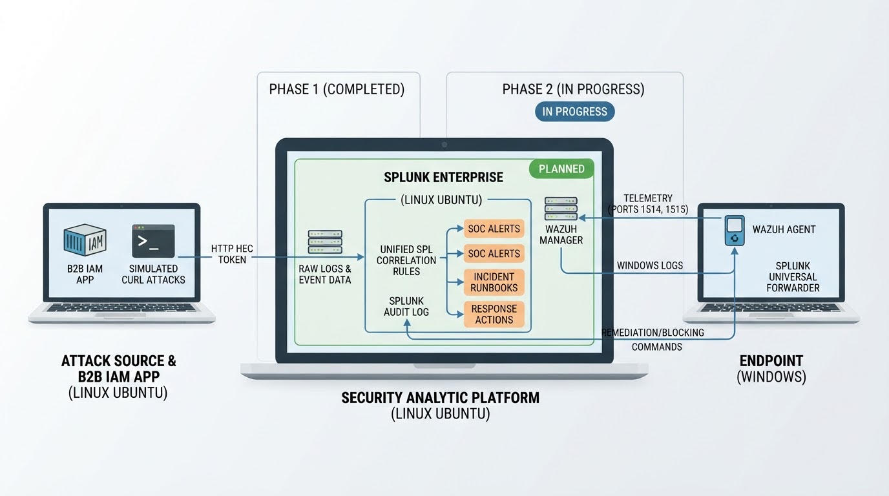

# Phase 2: Windows Endpoint Telemetry to Linux Wazuh Manager (Manager-Only)

## Architecture Overview
This home lab spans three phases:
- **Phase 1 (Completed):** B2B IAM threat monitoring and correlation in Splunk using HTTP Event Collector (HEC), `curl` attack simulations (brute-force, privilege escalation, and cross-tenant access), and Splunk dashboards.
- **Phase 2 (Current):** Endpoint telemetry collection from a Windows workstation (`<WINDOWS-ENDPOINT-IP>`) into a Wazuh Manager (`v4.14.10`) running on Linux (`<WAZUH-MANAGER-IP>`).
- **Phase 3 (Next):** Forwarding Wazuh alerts (`/var/ossec/logs/alerts/alerts.json`) into **Splunk Enterprise** on Linux for centralized indexing, correlation, incident runbooks, and dashboards.



## Why Manager-Only (No Local Indexer or Dashboard in Phase 2)
- **Resource conservation:** Avoids running heavy local indexer and dashboard daemons alongside the Wazuh Manager on the Linux host.
- **Clear separation of responsibilities:** Wazuh Manager handles agent enrollment, rule evaluation, and alert generation into `/var/ossec/logs/alerts/alerts.json`, while **Splunk Enterprise** serves as the centralized indexer and visualization platform in Phase 3.

---

## Step-by-Step Build, Errors Hit & Resolutions

### 1. Deploy Wazuh Manager (Linux) & Wazuh Agent (Windows)
- Installed **Wazuh Manager** (`v4.14.10`) on Linux (`<WAZUH-MANAGER-IP>`).
- Installed and enrolled the **Wazuh Agent** (`<WINDOWS-AGENT>`, ID `001`, IP `<WINDOWS-ENDPOINT-IP>`) on Windows to communicate with the manager over ports `1514` (event telemetry) and `1515` (agent enrollment).

---

### 2. Error & Fix: Root Disk Space Exhaustion & `wazuh-db` / `dbsync` Failure
- **Symptom / Error:** The Wazuh Manager service destabilized and `wazuh-db` / `dbsync` threw errors because root disk space hit 100% capacity.
- **Root Cause:** A `10.6 GB` vulnerability database archive (`vd_1.0.0_vd_4.13.0.tar`) had accumulated inside `/var/ossec/tmp`.
- **Resolution:** Deleted the oversized archive from `/var/ossec/tmp` and disabled `<vulnerability-detection>` (`<enabled>no</enabled>`) in `/var/ossec/etc/ossec.conf` so it would not re-download and fill the disk again.
- **Result:** Root disk usage dropped back to **74%** (**9.7G** free) and `wazuh-db` stabilized.

---

### 3. Error & Fix: `indexer-connector` & `InventoryHarvesterFacade` Retry Warnings (Port `9200`)
- **Symptom / Error:** Even without a local Wazuh Indexer installed (since Splunk handles indexing in Phase 3), `ossec.log` logged `indexer-connector` and `InventoryHarvesterFacade` connection retry warnings on startup while attempting to reach `127.0.0.1:9200`.
- **Resolution & Commands:** Disabled the `<indexer>` block (`<enabled>no</enabled>`) inside `/var/ossec/etc/ossec.conf`, verified the configuration lines, and restarted Wazuh Manager:

```bash
sudo sed -i '/<indexer>/,/<\/indexer>/ s/<enabled>yes<\/enabled>/<enabled>no<\/enabled>/' /var/ossec/etc/ossec.conf
sudo grep -n -A 4 "<indexer>" /var/ossec/etc/ossec.conf
sudo /var/ossec/bin/wazuh-control restart
```

---

### 4. Verification: Active Agent Status & Clean Manager Logs
Confirmed that the local server (`000`) and Windows endpoint (`001`) were actively connected and that File Integrity Monitoring (FIM), Security Configuration Assessment (SCA), and rootcheck scans ran without `wazuh-db` or `dbsync` errors:

```bash
sudo /var/ossec/bin/agent_control -l
sudo tail -n 15 /var/ossec/logs/ossec.log
```

**Verified Output:**
- `ID: 000, Name: <LINUX-MANAGER-HOST> (server), IP: 127.0.0.1, Active/Local`
- `ID: 001, Name: <WINDOWS-AGENT>, IP: any, Active`

---

### 5. Verification: Live JSON Alert Generation (`alerts.json`)
Verified that `/var/ossec/logs/alerts/alerts.json` exists with a non-zero file size and actively writes structured JSON alerts ready for **Phase 3** ingestion into Splunk Enterprise:

```bash
sudo ls -lh /var/ossec/logs/alerts/
sudo tail -n 2 /var/ossec/logs/alerts/alerts.json
```
